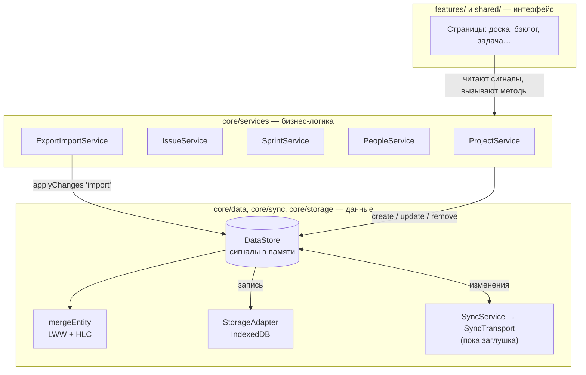

# Архитектура

Документ объясняет, как устроен код и почему именно так. Читайте сверху вниз — каждый раздел опирается на предыдущий.

## Главная идея: local-first

Приложение не ходит на сервер. Источник правды — **база IndexedDB в браузере**. Это даёт:

- мгновенный отклик (нет сетевых запросов);
- работу офлайн;
- приватность (данные никуда не уходят).

Цена — данные живут на одном устройстве. Поэтому код с самого начала устроен так, чтобы позже добавить
**синхронизацию между устройствами** (сначала через файл экспорта, потом через P2P) без переписывания.

## Слои



| Слой | Папка | Что делает | Чего НЕ делает |
| --- | --- | --- | --- |
| **Интерфейс** | `features/`, `shared/` | Показывает данные, реагирует на действия пользователя | Не меняет данные напрямую — только через сервисы |
| **Бизнес-логика** | `core/services/` | Правила: нумерация задач, один активный спринт, история изменений, каскадное удаление | Не знает про IndexedDB и HTML |
| **Данные** | `core/data/`, `core/sync/`, `core/storage/` | Хранит сущности, сливает изменения, пишет на диск | Не знает, что такое «спринт» или «задача» |

Правило зависимостей: **стрелки идут только вниз**. `DataStore` не импортирует сервисы, сервисы не импортируют компоненты.

## Поток данных на примере

Пользователь перетащил карточку `WEB-5` в колонку «В работе»:

1. `BoardPage.drop()` вызывает `IssueService.move(id, { statusId: 'in_progress' }, соседи, позиция)`.
2. `IssueService` считает новую позицию (`orderBetween`) и вызывает `update()`, который:
   - вызывает `DataStore.update('issues', id, { statusId, order })`;
   - сравнивает «до» и «после» и пишет запись в историю (`activity`).
3. `DataStore.update` оставляет только реально изменившиеся поля, ставит каждому **HLC-метку** и вызывает `applyChanges(…, 'local')`.
4. `applyChanges`:
   - сливает изменение с текущей версией (`mergeEntity`);
   - обновляет **сигнал** коллекции → Angular сам перерисовывает всё, что от него зависит (доску, счётчики, дашборд);
   - ставит запись в очередь на сохранение в IndexedDB;
   - уведомляет подписчиков (`onChange`) — через это будущий P2P отправит изменение другим устройствам.

Интерфейс обновляется **синхронно**, а запись на диск идёт в фоне по очереди. Если запись упадёт
(например, закончилось место), `DataStore.persistError` станет не `null` и оболочка покажет уведомление.

## Реактивность: сигналы

Всё состояние — это [сигналы Angular](https://angular.dev/guide/signals):

```ts
// core/services/issue.service.ts
readonly issues = this.store.list('issues');      // Signal<Issue[]>

// в компоненте
protected readonly mine = computed(() =>
  this.issues.issues().filter((i) => i.assigneeId === this.people.me()?.id),
);
```

`computed` пересчитывается автоматически, когда меняется любой прочитанный внутри сигнал. Поэтому
не нужны ни подписки RxJS, ни ручное обновление: изменили данные — всё, что их показывает, обновилось.

Приложение работает **без zone.js** (zoneless) — Angular перерисовывает только то, что зависит от изменившихся сигналов.

## Ключевые файлы

### `core/models/entities.ts`
Типы всех сущностей. У каждой есть служебные поля из `BaseEntity`:

- `id` — UUID;
- `createdAt`, `updatedAt` — время в мс;
- `deleted` — мягкое удаление («надгробие»);
- `clock` — HLC-метка последнего изменения **каждого поля**.

Подробно о полях — [data-model.md](data-model.md).

### `core/data/data-store.ts`
Единственное место, где данные меняются. Методы:

| Метод | Назначение |
| --- | --- |
| `init()` | Загрузить всё из хранилища при старте |
| `list(c)` | Реактивный список живых сущностей коллекции |
| `get(c, id)` | Одна сущность по id |
| `create / update / remove` | Локальные изменения |
| `applyChanges(changes, origin)` | Единая точка слияния: локальные правки, импорт, будущие пиры |
| `replaceAll(snapshot)` | Импорт в режиме «заменить» |
| `snapshot()` | Все данные для экспорта |
| `onChange(listener)` | Подписка на применённые изменения |

### `core/sync/`
- `hlc.ts` — гибридные логические часы: метки, которые всегда растут и сравниваются как строки.
- `merge.ts` — `mergeEntity`: слияние «последняя запись побеждает» для каждого поля (CRDT).
- `sync-transport.ts` — интерфейс транспорта и заглушка `NoopSyncTransport`.
- `sync.service.ts` — соединяет `DataStore` и транспорт.

Подробно — [p2p-sync.md](p2p-sync.md).

### `core/storage/`
`StorageAdapter` — интерфейс хранилища. Реализации: `IndexedDbStorage` (в браузере) и `MemoryStorage` (в тестах).
Подмена — через токен `STORAGE_ADAPTER`.

### `core/services/`
Доменные сервисы. Здесь живут правила предметной области:

- `ProjectService` — ключи проектов, статусы, текущий проект, каскадное удаление;
- `IssueService` — создание с нумерацией, история изменений, перемещение, подзадачи, комментарии;
- `SprintService` — один активный спринт на проект, завершение с переносом задач;
- `PeopleService` — участники и «я» на этом устройстве;
- `ExportImportService` — JSON/CSV, проверка и импорт файла;
- `SettingsService` — настройки **устройства** (тема, кто «я», последний проект) в `localStorage`. Они не синхронизируются.
- `ThemeService`, `PwaService`, `ToastService`, `DemoDataService` — вспомогательные.

### `features/`
Экраны. Каждая страница — standalone-компонент, загружается лениво (см. `app.routes.ts`).
Параметры адреса приходят в `input()` компонента автоматически, например `projectKey` для `/p/:projectKey/board`.

| Папка | Экран |
| --- | --- |
| `dashboard/` | Обзор: цифры, мои задачи, сроки, лента событий |
| `projects/` | Список проектов, диалог проекта, настройки проекта и статусов, переключатель |
| `board/` | Доска (канбан) |
| `backlog/` | Бэклог, спринты и их диалоги |
| `issues/` | Список с фильтрами, страница задачи, диалог создания, карточка и строка задачи |
| `settings/` | Настройки, импорт |
| `actions.service.ts` | Общие действия: «создать задачу», «создать проект» |

### `shared/`
Компоненты без бизнес-логики: `Icon`, `Avatar`, значки типа/приоритета/статуса, `PageHeader`, `EmptyState`,
`LabelsInput`, `Toasts`, а также диалоги (`DialogService`, `DialogFrame`, `ConfirmDialog`).

## Стили

- Tailwind CSS 4, классы пишутся прямо в шаблонах.
- В `src/styles.css` — тема (акцентный цвет `brand`), тёмная тема (класс `dark` на `<html>`) и
  переиспользуемые классы через `@utility`: `btn-primary`, `btn-secondary`, `input`, `label`, `card`, `chip`, `menu` и др.
- **Mobile first**: сначала пишем стили для телефона, затем уточняем для больших экранов префиксами `sm:` / `lg:`.
- Диалоги на телефоне — «шторки» снизу, на компьютере — окна по центру (`.app-dialog` в `styles.css`).

## Миграции данных

Если меняется структура хранилища IndexedDB (новая коллекция), увеличьте `DB_VERSION` в
`core/storage/indexeddb-storage.ts` и добавьте создание хранилища в `upgrade`.

Если меняются поля сущностей, данные пользователей не мигрируют сами. Варианты:

- **Новое необязательное поле** — делайте его `null`-able и обрабатывайте отсутствие (`issue.newField ?? значение`).
- **Переименование/смена смысла** — напишите миграцию в `DataStore.init()` после `load()` и
  увеличьте `formatVersion` экспорта с обработкой старой версии в `ExportImportService.parse()`.

Рецепт «как добавить поле» — в [contributing.md](contributing.md#рецепт-добавить-поле-задаче).
