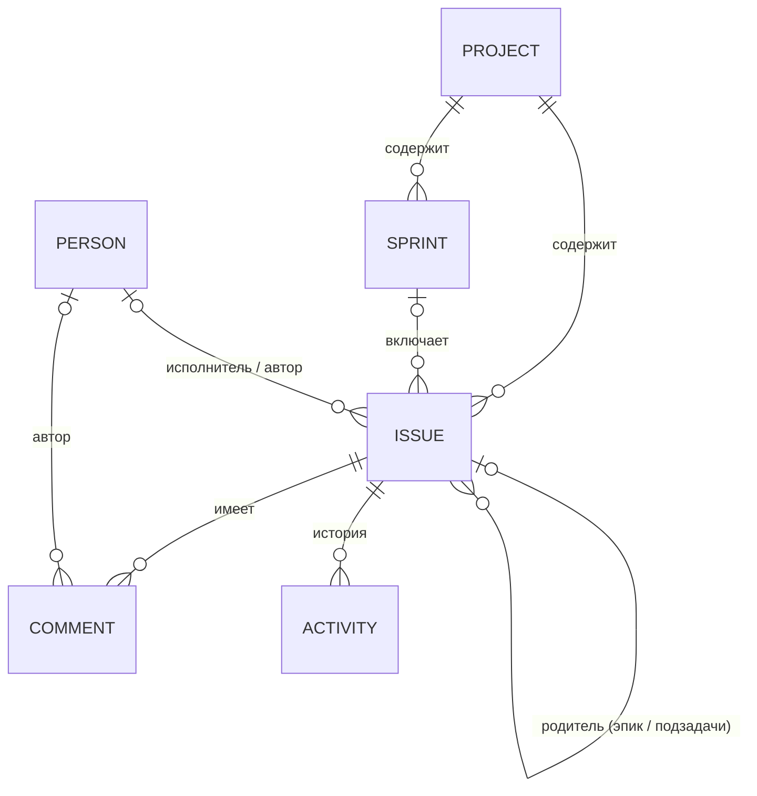

# Модель данных

Типы описаны в `src/app/core/models/entities.ts`. Здесь — то же самое человеческим языком.

## Общие поля всех сущностей (`BaseEntity`)

| Поле | Тип | Описание |
| --- | --- | --- |
| `id` | `string` | UUID v4. Генерируется на устройстве, поэтому уникален без сервера |
| `createdAt` | `number` | Время создания, мс с 1970 года |
| `updatedAt` | `number` | Время последнего изменения |
| `deleted` | `boolean` | `true` — запись удалена. Физически не стирается, чтобы удаление «доехало» до других устройств |
| `clock` | `Record<string, string>` | Для каждого поля — HLC-метка его последнего изменения. Используется при слиянии |

## Коллекции



### `projects` — проекты

| Поле | Описание |
| --- | --- |
| `key` | Ключ, 2–10 латинских букв/цифр, начинается с буквы. Не меняется после создания |
| `name`, `description` | Название и описание |
| `color` | Один из `indigo, sky, emerald, amber, rose, violet, teal, orange` |
| `statuses` | Упорядоченный массив статусов `{ id, name, category }`. Порядок = порядок колонок доски |
| `issueCounter` | Последний выданный номер задачи |

`category` статуса: `todo` (серый), `in_progress` (синий), `done` (зелёный, задача считается завершённой).

### `issues` — задачи

| Поле | Описание |
| --- | --- |
| `projectId` | Проект |
| `number` | Номер в проекте. Ключ задачи = `${project.key}-${number}` |
| `type` | `epic`, `story`, `task`, `bug`, `subtask` |
| `title`, `description` | Название (обязательно) и описание (простой текст) |
| `statusId` | `id` статуса из `project.statuses` |
| `priority` | `highest`, `high`, `medium`, `low`, `lowest` |
| `assigneeId`, `reporterId` | Исполнитель и автор (`people`) или `null` |
| `labels` | Массив меток без пробелов |
| `storyPoints` | Число или `null` |
| `dueDate` | Срок `YYYY-MM-DD` или `null` |
| `parentId` | Для задачи — эпик; для подзадачи — родительская задача |
| `sprintId` | Спринт или `null` (бэклог). Подзадача всегда в спринте родителя |
| `order` | Позиция в списке (дробное число, меньше — выше). См. «Порядок» ниже |

### `sprints` — спринты

| Поле | Описание |
| --- | --- |
| `projectId` | Проект |
| `name`, `goal` | Название и цель |
| `state` | `planned` → `active` → `closed`. В проекте не больше одного `active` |
| `startDate`, `endDate` | `YYYY-MM-DD` или `null` |

### `people` — участники

`name`, `email`, `color`. Кто из участников — «я» на этом устройстве, хранится отдельно в настройках устройства
(`localStorage`, ключ `task-tracker.settings`, поле `currentUserId`).

### `comments` — комментарии

`issueId`, `authorId`, `body` (простой текст).

### `activity` — история изменений

Записи только добавляются. `issueId`, `actorId`, `kind` (`created` / `changed` / `commented`),
`field` (имя поля задачи), `from`, `to` — **человекочитаемые** значения на момент изменения
(например, имя статуса, а не его id), чтобы история оставалась понятной после удаления статуса или человека.

## Порядок (`order`)

При перетаскивании меняется `order` **только у перемещённой задачи**: новое значение — середина между соседями
(`orderBetween` в `core/utils/order.ts`). Это важно для синхронизации — меньше изменённых записей, меньше конфликтов.

## Формат файла резервной копии

Файл `task-tracker-ГГГГ-ММ-ДД.json`:

```jsonc
{
  "app": "task-tracker",          // признак «наш» файл
  "formatVersion": 1,             // версия формата
  "exportedAt": "2026-11-11T10:00:00.000Z",
  "replicaId": "a1b2c3d4",        // id устройства, сделавшего экспорт
  "data": {
    "projects": [ /* сущности целиком, включая deleted и clock */ ],
    "issues":   [ ],
    "sprints":  [ ],
    "people":   [ ],
    "comments": [ ],
    "activity": [ ]
  }
}
```

Удалённые записи (`deleted: true`) **входят** в экспорт — иначе при слиянии удалённая задача «воскресла» бы.

При импорте проверяется: это JSON, `app === "task-tracker"`, поддерживаемая `formatVersion`,
у каждой записи есть строковый `id` и объект `clock`. Ошибки показываются пользователю понятным текстом.

### Пример задачи в файле

```json
{
  "id": "6f1c…",
  "projectId": "0a9e…",
  "number": 2,
  "type": "story",
  "title": "Экран входа по email",
  "description": "",
  "statusId": "in_progress",
  "priority": "high",
  "assigneeId": "c3d4…",
  "reporterId": "c3d4…",
  "labels": ["ui"],
  "storyPoints": 5,
  "dueDate": null,
  "parentId": "9b8a…",
  "sprintId": "77aa…",
  "order": 3000,
  "createdAt": 1762855000000,
  "updatedAt": 1762855100000,
  "deleted": false,
  "clock": {
    "title": "1762855000000:00000:a1b2c3d4",
    "statusId": "1762855100000:00000:a1b2c3d4",
    "…": "…"
  }
}
```
