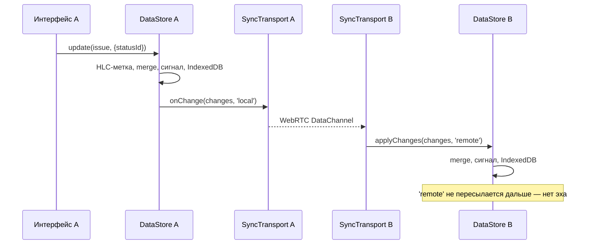

# P2P-синхронизация: задел и план

Цель на будущее: несколько устройств соединяются **напрямую** (peer-to-peer, без своего сервера с данными),
видят изменения друг друга **в реальном времени** и могут редактировать одно и то же одновременно.

Сейчас это **не реализовано**, но всё, что сложно добавить потом, уже заложено. Документ объясняет,
что именно сделано, почему, и что останется доделать.

## Что уже готово

| Механизм | Где | Зачем |
| --- | --- | --- |
| UUID у всех сущностей | `DataStore.create` | Два устройства могут создавать записи офлайн без конфликтов id |
| HLC-метка у каждого поля | `BaseEntity.clock`, `core/sync/hlc.ts` | Определить, какое из двух изменений «позже», даже если часы устройств расходятся |
| Слияние LWW по полям (CRDT) | `core/sync/merge.ts` | Детерминированно объединить данные двух устройств |
| Мягкое удаление | `BaseEntity.deleted` | Удаление тоже «изменение», которое можно передать пиру |
| Единая точка входа изменений | `DataStore.applyChanges(changes, origin)` | Изменения от пира применяются так же, как локальные и импорт |
| Минимальные изменения | `DataStore.update` пишет только изменившиеся поля; `order` — дробный | Меньше конфликтов и трафика |
| Интерфейс транспорта | `core/sync/sync-transport.ts` | Подключить WebRTC (или что угодно) без правок остального кода |
| Связка «хранилище ↔ транспорт» | `core/sync/sync.service.ts` | Уже отправляет локальные изменения и применяет входящие (без эха) |
| ID устройства | `DataStore.replicaId` | Входит в HLC-метки, разрешает ничьи |

Всё это **уже работает и проверено тестами** на импорте в режиме «Объединить»: файл экспорта — это,
по сути, «пакет изменений от другого пира». См. `export-import.service.spec.ts`.

## Как это работает

### Гибридные логические часы (HLC)

Обычное время устройства ненадёжно: часы могут отставать или откатываться. HLC — это пара
«физическое время + счётчик» плюс id устройства:

```
1762855100000:00003:a1b2c3d4
└── время, мс ─┘└─счётчик┘└─ устройство ─┘
```

Свойства:
- каждая новая метка **больше** предыдущей на этом устройстве (монотонность);
- получив чужую метку (`receive`), устройство «подтягивает» свои часы, и его следующие метки будут больше;
- метки сравниваются **как строки**; при полном совпадении времени и счётчика побеждает больший id устройства.

### Слияние «последняя запись побеждает» по полям (LWW-Map)

Для каждого поля хранится метка последнего изменения. При слиянии берётся значение с **большей** меткой.

```
Устройство A меняет title  в 10:00 → title = «Новое», clock.title = 10:00:A
Устройство B меняет status в 10:01 → status = «Готово», clock.statusId = 10:01:B

После обмена на ОБОИХ устройствах: title = «Новое», status = «Готово»
```

Разные поля одной задачи не конфликтуют. Если два устройства поменяли **одно** поле — останется более позднее.

Слияние **коммутативно** (порядок получения не важен) и **идемпотентно** (повторное получение ничего не ломает) —
значит, можно не заботиться о порядке и дублях сообщений в сети.

### Поток изменений



## Что останется сделать

### 1. Реализовать транспорт

Создать класс, реализующий `SyncTransport`, и подключить его в `app.config.ts`:

```ts
providers: [
  { provide: SYNC_TRANSPORT, useClass: WebRtcSyncTransport },
]
```

Варианты:

| Вариант | Плюсы | Минусы |
| --- | --- | --- |
| **WebRTC DataChannel** + свой маленький signaling-сервер (WebSocket) | Полный контроль, данные идут напрямую | Нужен signaling и STUN/TURN |
| [PeerJS](https://peerjs.com) | Простой API, есть публичный signaling | Зависимость от стороннего сервера |
| [Trystero](https://github.com/dmotz/trystero) | Signaling через публичные сети (Nostr, BitTorrent, MQTT) — без своего сервера | Меньше контроля |
| `BroadcastChannel` | Синхронизация вкладок одного браузера, 20 строк кода | Только одно устройство |

Рекомендуемый первый шаг — `BroadcastChannel`: он проверит всю цепочку без сети.

### 2. Начальная синхронизация (catch-up)

Когда пир подключается, ему нужно получить всё, что он пропустил. Простейший вариант: обменяться
`DataStore.snapshot()` целиком (как при импорте). Оптимизация: передавать только сущности, у которых
`maxClock(entity)` больше последней метки, которую пир уже видел.

### 3. Известные ограничения, которые придётся решить

| Проблема | Почему возникает | Возможное решение |
| --- | --- | --- |
| **Одинаковые номера задач** | `issueCounter` увеличивается локально; два офлайн-устройства выдадут `WEB-5` дважды | Обнаруживать дубль при слиянии и перенумеровывать более позднюю задачу; или номер = счётчик + суффикс устройства |
| **Статусы проекта** | `statuses` — массив, сливается целиком | Хранить статусы отдельной коллекцией |
| **Метки** | Массив `labels` сливается целиком: одновременное добавление разных меток потеряет одну | OR-Set CRDT для меток |
| **Описание** | Одновременная правка текста — побеждает одна версия | Текстовый CRDT (например, [Yjs](https://yjs.dev)) для поля `description` |
| **Два активных спринта** | Два устройства офлайн запустили разные спринты | Правило разрешения при слиянии (оставить с большей меткой) |
| **История растёт** | `activity` только добавляется | Периодически сжимать старые записи |
| **«Удалить всё»** | `replaceAll` стирает надгробия; пир вернёт данные | В режиме синхронизации делать удаление через `remove` для каждой записи |
| **Безопасность** | Любой пир может прислать что угодно | Комнаты с секретом, шифрование, проверка структуры входящих изменений |

### 4. Участники и присутствие

`people` уже синхронизируемая коллекция. Нужно связать участника с устройством (например, хранить
`personId` при подключении) и показывать, кто сейчас онлайн и что открыл (presence) — это эфемерные
данные, их лучше передавать отдельным каналом и не сохранять.

## Как проверить свою реализацию

1. Тесты `core/sync/sync.service.spec.ts` показывают, как подменить транспорт фейком.
2. Напишите тест «два `DataStore` + два фейковых транспорта, соединённых друг с другом», внесите
   конфликтующие изменения и проверьте, что состояния сошлись.
3. Для ручной проверки откройте приложение в двух окнах браузера (с `BroadcastChannel`-транспортом).
